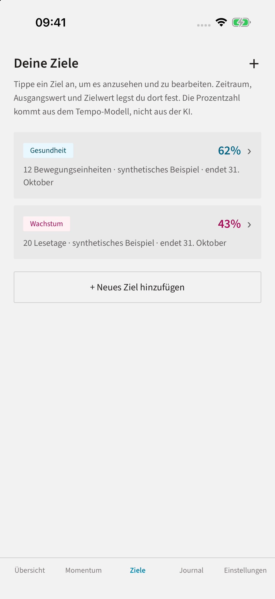
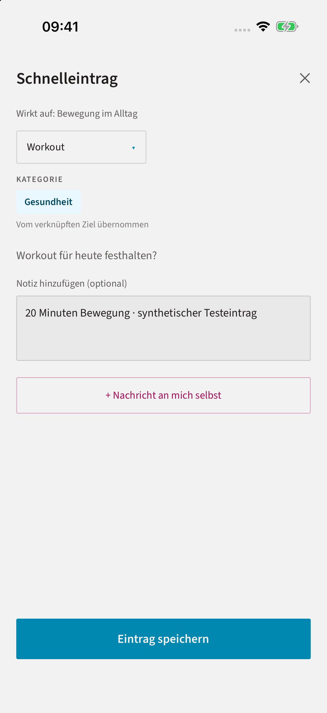

# Predictive Mentoring · MIOVO

**Von einer langfristigen Vision zu konkreten Zielen, kleinen Handlungen und einer reflektierten Sicht auf den eigenen Fortschritt.**

MIOVO ist ein mobiler React-Native-/Expo-Prototyp für persönliche Zielarbeit. Die Idee: Ziele nicht nur aufschreiben, sondern Beobachtungen im Alltag erfassen, den Verlauf einordnen und einen nächsten machbaren Schritt finden. Das ist ein Produkt- und Architektur-Showcase, keine ausgelieferte Mentoring-Plattform.


Das vorhandene App-Icon ist ein visuelles Asset, **kein Screenshot und kein Funktionsnachweis**.

## Vom Ziel zur nächsten Handlung

Die folgenden Bilder zeigen **die tatsächlich laufende App im iOS-Simulator** (iPhone 17 Pro, iOS 26.5, Expo Go 57.0.9), ausschließlich mit synthetischen Zielen und Einträgen. Keine Mockups, keine Web-Vorschau, kein Nachweis eines signierten App-Builds oder eines physischen Geräts. Der lokale Helfer ist aktiv; Apple Intelligence / Gemini Nano wurden nicht ausgeführt.

### 1 · Ziele überschaubar halten



Zwei Monatsziele machen den nächsten Fokus sichtbar: Bewegung und Lesen. Die dargestellten 62 % und 43 % stammen aus dem heuristischen Tempo-Modell mit erfundenen Einträgen — nicht aus gemessenen Nutzererfolgen.

### 2 · Eine Alltagshandlung dem richtigen Ziel zuordnen



Der Schnelleintrag übernimmt Ziel, Eintragstyp und Kategorie. Das Bild zeigt die ausgefüllte Notiz **vor** dem Speichern; anschließend wurde der Eintrag über die App gespeichert und in der isolierten SQLite-Datenbank nachgewiesen.

### 3 · Den Verlauf einordnen und einen kleinen Impuls finden


Nach dem synthetischen Workout zeigt Gesundheit 66 % statt 62 %; Wachstum bleibt bei 43 %. Das belegt die Reaktion dieses Prototyp-Pfads, **keine kalibrierte Wahrscheinlichkeit oder Wirksamkeit**. Die Vorschlagsvorschau ist im Original-UI auf drei Zeilen gekürzt; der vollständige Impuls ließ sich öffnen. Der Hinweis auf nicht verfügbare On-Device-KI bleibt bewusst sichtbar.

[Aufnahmeherkunft, synthetischer Datensatz und Bildhashes](docs/SCREENSHOTS.json) · [Prüfumfang und Grenzen](docs/VALIDATION.md)

## Produktfluss

1. **Orientierung:** Eine Vision wird in Meilensteine, aktuelle Ziele und tägliche Handlungen gegliedert. Vorschläge können vor der Übernahme bearbeitet werden.
2. **Handeln:** Manuelle Einträge verbinden Gewohnheiten, Bewegung, Stimmung oder Ausgaben mit einem Ziel; nicht zugeordnete Einträge bleiben Journal-Inhalte.
3. **Reflektieren:** Ein lokales, regelbasiertes Modell berechnet einen On-Track-Wert und Trend. Ein Mentoring-Impuls kann einen kleinen nächsten Schritt formulieren.

Der angestrebte Nutzen ist weniger Abstand zwischen Vorhaben und Alltag. **Eine Verbesserung der Zielerreichung oder des Wohlbefindens wurde hier nicht gemessen.** Erfasste Handlungen und numerische Fortschritte sind keine nachgewiesenen persönlichen Outcomes.

## Was ist belegt – und was nicht?

| Einordnung | Stand im inspizierten Quellcode |
| --- | --- |
| Implementierte Prototyp-Pfade | Zielhierarchie, manuelle Logs, Journal, Zielbearbeitung, Momentum-Ansicht, Export und lokale Löschung. Zielübersicht → Workout-Schnelleintrag → aktualisierte Übersicht und Vorschlagsdetail hier im iOS-Simulator ausgeführt; übrige Pfade nur statisch inspiziert. |
| Lokale Datenverarbeitung | SQLite für App-Inhalte; Berechnung des On-Track-Werts getrennt von Sprachgenerierung. Anmeldung nutzt einen externen Dienst. |
| On-Device-Modellpfad | Adapter für Apple Foundation Models / Gemini Nano über `expo-local-llm`, inklusive Verfügbarkeitsprüfung. Native Integration vorhanden, erfolgreicher Geräteeinsatz hier **nicht** nachgewiesen. |
| Deterministischer Ersatz | Routing auf einen lokalen Helfer bei fehlendem oder ladendem OS-Modell; Regeln und Textvorlagen statt Cloud-LLM. Ausgewählte reine Funktionen sind hier ausführbar. |
| Nicht ausgeliefert bzw. nicht belegt | Health-/Kalender-Anbindungen sind als „Demnächst“ gesperrt. Kein Nachweis für Store-Release, Push-Betrieb, Modellkalibrierung, klinische Wirkung oder Produktionsreife. |

**„Wahrscheinlichkeit“ ist die Bezeichnung im Prototyp, keine validierte Erfolgswahrscheinlichkeit.** Die Berechnung verwendet gesetzte Konstanten und Pace-Heuristiken, keine hier belegten Populationsdaten. Ein `confidence`-Label ist kein statistisches Konfidenzintervall. Auch unveränderte Originalkommentare und Vorlagentexte in den Auszügen können stärker formuliert sein; maßgeblich für dieses Showcase ist diese Einschränkung.

## Technik und überprüfbare Auszüge

React Native · Expo · TypeScript · SQLite · Supabase Auth · optionale native OS-Sprachmodelle.

- [Architektur und Datenfluss](docs/ARCHITECTURE.md)
- [Status und Claim-Grenzen](docs/STATUS.md)
- [Sicherheits- und Datenschutzgrenzen](docs/SECURITY.md)
- [Codeauswahl und Herkunft](components/README.md)
- [Quellpfade und SHA-256-Nachweise](docs/PROVENANCE.json)
- [Lokale Validierung](docs/VALIDATION.md)

Die sechs unveränderten TypeScript-Dateien zeigen Runtime-Routing, lokale Textvorlagen, Kategorieheuristiken und eine reine Kontozuordnungsregel. Keine komplette App, kein SDK und kein Open-Source-Release.

### Lokal prüfen

Node.js ab 22.18 und Python 3, keine Installation, Konten oder Zugangsdaten erforderlich:

```bash
npm test
npm run validate
```

Die Tests verwenden ausschließlich synthetische Eingaben und prüfen konkrete Funktionen, nicht die native App oder die Qualität eines Sprachmodells. Das Validierungsskript prüft Inventar, Dateihashes, lokale Markdown-Dateiverweise und einen begrenzten Satz sensibler Muster. Es ist kein umfassender Security-Audit.

## Umfang und Rechte

Dieses eigenständige Repository enthält nur explizit ausgewählte Inhalte. Private Git-Historie, Betriebs-/Build-Konfiguration, Datenbanken, Exporte, Testpersonen-Daten und interne Arbeitsanweisungen wurden nicht übernommen. Der vollständige Produktcode bleibt privat.

Alle eigenen Texte, Bilder und Codeauszüge bleiben **proprietär**; siehe [LICENSE](LICENSE). Dieses eigenständige Showcase wird mit Freigabe des Eigentümers öffentlich bereitgestellt. Der vollständige Produktcode und seine Git-Historie bleiben privat.
