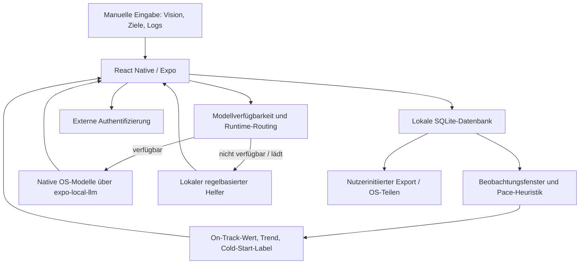

# Architektur

## Zuständigkeiten

Die Grafik beschreibt den inspizierten privaten Code, nicht den Umfang der hier ausführbaren Auszüge. Sie ist kein Nachweis beobachteten Netzwerkverkehrs.

## Domäne und Speicherung

`Goal` trennt Lebensbereich, Tracking-Typ, Zeithorizont und Hierarchieebene. Visionen, Meilensteine, aktuelle Ziele und Handlungen werden über Elternreferenzen verbunden. `DataPoint.goalId` ordnet manuelle Beobachtungen einem Ziel zu; nicht zugeordnete Einträge sind Journal-Inhalte. SQLite-Migrationen und lokale Tabellen für Ziele, Einträge, Vorhersagen, Vorschläge, Verbindungen und Selbstnachrichten sind vorhanden.

Kontozuordnung ist eine lokale Besitzerkennung mit Adoptions-/Konfliktpfad. Die reine Entscheidungsregel ist enthalten, die Datenbankintegration nicht. Das ist keine kryptografische Mandantentrennung.

## Zahlenmodell ist nicht Sprachmodell

`services/prediction/observe.ts` bildet Zeitfenster, ordnet Daten einem Ziel zu und aggregiert Beobachtungen. `model.ts` vermischt einen gesetzten Startwert (0.55, Stärke 8) mit einer sigmoidalen Pace-Funktion und einer Horizontkorrektur. Kategorien mitteln Zielwerte. Trend und `confidence` folgen festen Schwellen.

Das ist eine nachvollziehbare heuristische Berechnung, kein hier empirisch kalibriertes Prognosemodell. Modellname und Codekommentar allein belegen weder Populationsdaten noch eine wissenschaftliche Validierung. Gesundheits-/Finanzkategorien machen daraus keine medizinische oder finanzielle Beratung. Unterschiedliche Zielrichtungen, fehlende Logs, Stimmungswerte und Ausgaben verlangen weitere Domänenprüfung.

## Sprachpfad und Fallback

Die Fassade bietet Vision-Aufteilung, Klassifikation, Chat und Formulierung. Der native Adapter fragt Modellverfügbarkeit ab; bei Android kann ein erforderlicher Modelldownload angestoßen werden. Ein Custom Native Build ist erforderlich, Expo Go allein genügt nicht.

`decideRuntime` wählt das OS-Modell nur bei `available`, andernfalls `local`. `fallback.ts` liefert feste, kategoriebasierte Vorschläge und eine kurze Chat-Schablone; `categories.ts` klassifiziert per Schlüsselwort. Das sind keine generativen Ersatzmodelle. Die Vision-Aufteilung im vollständigen lokalen Helfer verwendet zusätzlich aktuelle Datumswerte: deterministische Regeln bedeuten dort nicht bytegleiche Ergebnisse über verschiedene Ausführungszeitpunkte.

Die Fehlerbehandlung ist pfadspezifisch: Vorschläge zeigen bei Generierungsfehlern eine Vorlage; der Chat zeigt bei Fehlern einen Wiederholhinweis. Das Routing ist **keine globale Garantie**, dass jeder Fehler einer bereits verfügbaren nativen Laufzeit transparent abgefangen wird. Chatverlauf liegt im inspizierten Screen-State, nicht in einem hier belegten sitzungsübergreifenden Gedächtnis.

## Absichtliche Showcase-Grenze

Kein App-Build, kein Auth-Client, keine native Laufzeit und keine Datenbank werden ausgeliefert. Tests führen nur die enthaltenen Originalfunktionen aus. Vollständige private Quellpfade und Fingerprints der für die Analyse relevanten Dateien stehen ohne Inhalte in [PROVENANCE.json](PROVENANCE.json).
